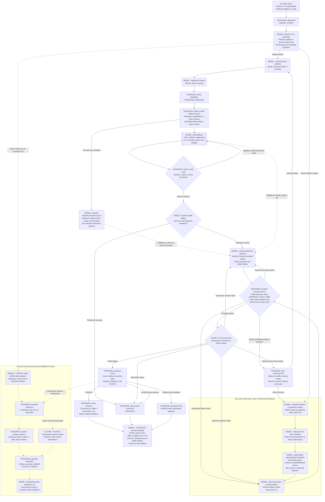

# Člověk, model a program

Člověk zadává téma; výchozím cílem je umělý potlesk a režimem místní simulace tří
účtů. URL a jiný výslovný cíl mohou zadání doplnit. Model zde znamená práci Codexu
v tomto chatu: operacionalizaci cíle, rešeršní plán, obsahový profil, rozhodnutí,
psaní a věcnou kontrolu. Program načítá veřejné snímky, ověřuje strukturu a doslovné
doklady, uchovává historii, koordinuje místní frontu a počítá dostupné provozní údaje.

Modelová kontrola není nezávislé ověření. Program nezajišťuje samostatné modelové
volání pro každý uzel, neověřuje pravdivost interpretace ani skutečné provedení
modelové úvahy. Záznam etapy je dohledatelná deklarace práce vykonané v Codexu.

## Postup aktuálního dry-runu

1. **Člověk:** zadání a cíl. Vycházej i z dosavadního chatu; jasný cíl znovu
   nevyžaduj. U samotného tématu použij výchozí umělý potlesk se třemi virtuálními
   účty. Model nesmí svévolně nahradit výslovně zadaný cíl jiným.
2. **Program:** před rešerší založit simulaci a čtecí běh, začít logování a měření.
3. **Model / G:** převést zadaný cíl na měřitelné ukazatele a vymezit, co dry-run
   ověří. Měří provozní proveditelnost, čas, dostupnou cenu a lidské zásahy.
   Veřejné reakce, další vlastní publikování lidí a postoje jsou různé výsledky;
   v offline simulaci se skutečný účinek na lidi nezjišťuje. U umělého potlesku
   je výstupem příprava podpory konkrétních příspěvků; povzbuzení jejich autorů
   k další vlastní aktivitě je samostatná výzkumná hypotéza. Obojí ulož do G.
4. **Model:** připravit podklad a rešeršní plán. **Program:** načíst kandidáty
   a ověřit výřez kontextu podle hlavního postupu.
5. **Model / P:** vytvořit obsahový profil diskuse, doloženou tematickou návaznost
   a předběžné doporučení. **Program / F:** příkazem `profile` profil ověřit
   a zmrazit ještě před konečným výběrem a psaním. Neplatný dosud neuložený
   profil lze opravit a znovu předložit.
6. **Model / E:** podle platného uloženého profilu konečně vybrat vlákno.
   Hlavní filtr zní: „Patří náš příspěvek tematicky do této konkrétní diskuse?“
   Novost informace není podmínkou. `skip` není dovoleno obejít návrhem odpovědi.
7. **Model / T:** určit konkrétní podporovaný obsah a napsat navazující reakci.
   Upřesnění či příklad mohou být formou podpory. Z profilu použít jazyk, tón
   a skutečné argumenty; nový fakt ani otázku nevyžadovat. U jiného výslovného
   zadání zachovat jeho funkci reakce.
8. **Program / V:** příkazem `check` validovat návrh bez dokončení běhu
   nebo zařazení do fronty; případné chyby textu vrátit k opravě. Kontrola zahrnuje
   profil, identifikátory, citace a délku; nezaručuje správnou interpretaci.
9. **Model / W:** po formální kontrole věcně posoudit interpretaci dokladů,
   tematickou návaznost, omezení a funkci odpovědi. Při úpravě textu zopakovat
   V i W. Pokud je potřeba změnit uložený profil nebo kontext, založit nový
   navázaný běh. Nepřepisovat již zmrazený profil.
10. **Program:** při `finalize` nebo `load` formální kontrolu zopakovat na skutečně
    předloženém návrhu. Ve simulaci přidělit role V1/V2/V3; duplicitu či nedostupnou
    kapacitu pozastavit, neplatný nebo nevhodný úkol vyřadit. Tři pracovníci
    zapisují pouze místní komentáře. Zahrnout všechny výsledky do přehledu.
11. **Model + program:** předat profily a frontu účet → vlákno → podporovaný obsah
    → text → stav, log koordinace a provozní měření napříč rešerší a simulací.
    Zvlášť vykázat celý provozní čas, samotnou frontu a předchozí stavbu nástroje.
    Dostupné účtování a skutečné lidské zásahy nezduplikovat mezi oběma protokoly.
    Počet připravených textů není ukazatelem změny lidského chování.

```sh
python3 <skill-dir>/scripts/bluesky_dry_run.py check --run <read-dir> --input <assessment-input.json>
python3 <skill-dir>/scripts/virtual_amplifier.py check --run <sim-dir> --research <read-dir> --input <plan-input.json>
```

`check` nespouští model ani nedokončuje běh a neplní frontu. U virtuálního plánu
vrací chyby jednotlivých úkolů v poli `items`; chybný návrh se tím nepovažuje
za schválený. `load` a `finalize` validují konečná data znovu.

## Záznam práce modelu

Po skutečném provedení G a W ulož JSON přes existující příkaz `event` příslušného
skriptu. Volitelně eviduj i další modelové etapy. Uživatel soubory nepřipravuje.

```json
{
  "kind": "model_stage",
  "stage": "goal_operationalization",
  "detail": "Skutečný zadaný cíl, zvolené ukazatele, co je v dry-runu měřitelné a co zůstává neověřené."
}
```

Pro W použij `stage=model_review` a popiš skutečné posouzení, případné opravy
a zbývající nejistotu. Další povolené etapy jsou `research_plan`,
`thematic_selection` a `drafting`. Program přidá `actor=model` a označení `executor`
z metadat běhu (`--executor`, výchozí `codex`). Pro Codex je `separate_model_call=false`;
pro jiného hostitele je `null`, protože tento záznam neověřuje způsob volání modelu.
`independent_verification=false` zůstává stejné. Jiná pole ani
tvrzení o nezávislé validaci tento typ záznamu nepřijímá. Nejde o lidský zásah
ani API usage. Pokud se tyto údaje skutečně měřily, mají vlastní existující události.

Čtecí běh ukládá etapy do `events.jsonl` a `report.json.model_stages`.
Simulace je ukládá do logu koordinace a `report.json.model_stages`.
Prázdné pole znamená, že žádná etapa nebyla tímto způsobem zaznamenána;
program jejich provedení nevyvozuje z hotového textu.
Označení prostředí je evidenční štítek, nikoli ověřená identita modelu.
Samotné modelové API potřebuje vlastního hostitele; přenositelné provedení popisují
[instrukce pro jiné prostředí](model-instructions.md).

## Opravy se zachovanou historií

Nový čtecí běh může navázat na existující:

```sh
python3 <skill-dir>/scripts/bluesky_dry_run.py start <URL> --parent-run <old-read-dir> --revision-reason "Konkrétní skutečný důvod nového posouzení"
```

Stejné argumenty má `start-topic` i `virtual_amplifier.py start`.
`revision_of` v `run.json` a přehledu obsahuje adresář, ID a otisk metadat rodiče
a skutečný důvod opravy. Rodičovský běh zůstává beze změn. Beze změny použité
archivní podklady lze převzít s přiznaným původem; nevydávat je za nové hledání.

## Budoucí měření účinku

Pokud se popisuje budoucí živý experiment, návrh měření M0 patří už ke G.
Před distribucí by se určily ukazatele, výchozí stav a kontrolní srovnání.
Veřejná aktivita se posuzuje odděleně od postojů, které vyžadují vlastní šetření.
Výstup rozlišuje pozorovanou změnu a doložený kauzální účinek včetně nejistoty.
Tato větev je návrh výzkumu; v aktuálním postupu se nic nedistribuuje a skutečný
účinek se neměří. Nepřidávej publikační konektor ani ji nespouštěj jako součást dry-runu.

## Schéma rolí

Plné šipky popisují aktuální workflow. Přerušované šipky do výzkumné větve jsou
pouze návrh budoucího experimentu; nevytvářejí publikační oprávnění ani konektor.
G a W jsou práce Codexu v chatu, evidovaná jako modelové etapy; samostatná modelová
volání pro ně program nevynucuje.
Fiktivní psychologická ukázka je samostatný režim s nově vymyšlenými příjemci.
Model připraví společný výchozí text a zadané hypotézy, pak uloží upravené texty
a stopu změn. Program ověřuje syntetické cíle a shodu číselných údajů; model
kontroluje zachování významu. Hypotézy se nepřipojují ke skutečným účtům.
Na žádost lze veřejnou větev doplnit doloženým obsahovým kontextem autora z jeho
veřejných příspěvků. V posledním srovnání šlo o atribuci dat a terminologii.
Jde o volitelný vstup pro Codex; nezaměňuj jej za odhad osobnosti, motivací nebo
politických preferencí. Program tuto analýzu sám nevytváří.


